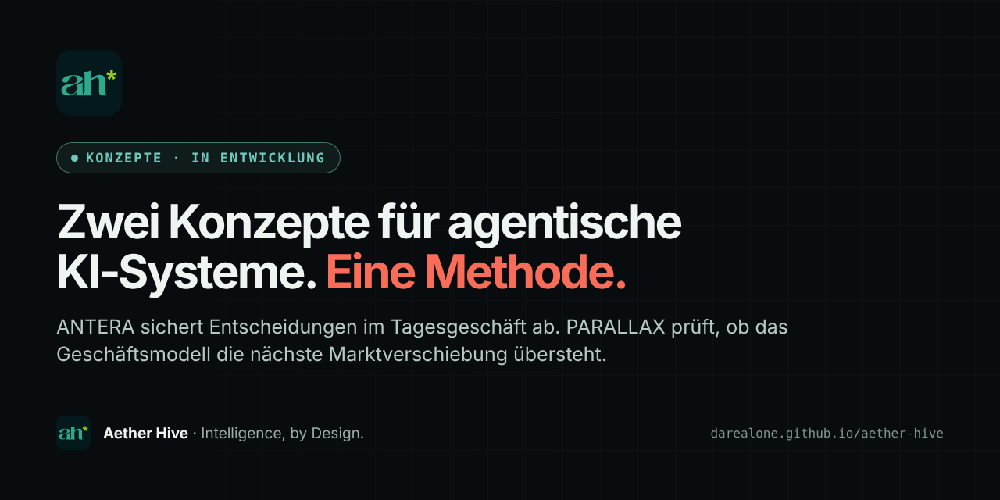

<p align="center"></p>

# Aether Hive

**Zwei Konzepte für agentische KI-Systeme, eine Methode.** ANTERA sichert Entscheidungen im Tagesgeschäft ab, von der Kampagne bis zum Deal. PARALLAX prüft, ob das Geschäftsmodell die nächste Marktverschiebung übersteht.

> **Status:** Konzepte in Entwicklung. Keine fertigen Produkte und keine Spiele. Die Demos zeigen den geplanten Ablauf mit fiktiven bzw. synthetischen Daten, es gibt keine Anbindung an echte Systeme.

**Live:** https://darealone.github.io/aether-hive/

---

## In short (English)

Two concepts for agentic AI systems from the studio Aether Hive. **ANTERA** protects marketing and sales decisions before launch, after each campaign run and inside live enterprise deals. **PARALLAX** detects structural business-model risks before they show up in the numbers. In both, the agent observes, investigates and prepares; deciding, starting and sending stay with humans. Both are concepts in development with demo data. The pages are in German.

## Die Konzepte

| | Worum es geht | Ansehen | Details |
|---|---|---|---|
| **ANTERA** | Agentisches System, das Entscheidungen in Marketing und Vertrieb absichert: Verhindern, Verstehen, Tragbar machen. „Darf stoppen. Nie starten.“ | [Konzeptseite](https://darealone.github.io/aether-hive/antera/) | [README](antera/README.md) |
| **PARALLAX** | Konzept und Offline-Prototyp, der strukturelle Risiken im Geschäftsmodell erkennt: Wirkpfade, Frühindikatoren, Widerlegungsbedingungen, Experimente. | [Prototyp](https://darealone.github.io/aether-hive/parallax/) | [README](parallax/README.md) |

## Die gemeinsame Methode

1. **Beobachten.** Was wurde tatsächlich gemessen?
2. **Ableiten.** Was folgt daraus, und wie sicher ist das?
3. **Widerlegen.** Was würde die Annahme kippen? Gegenbelege stehen gleichberechtigt daneben.
4. **Handeln.** Jede Erkenntnis mündet in eine Entscheidung oder ein Experiment mit Verantwortung.
5. **Lernen.** Ergebnisse kalibrieren die Regeln, durch Menschen.

Der Agent liest, untersucht und entwirft. Entscheiden, starten und senden bleibt beim Menschen.

## Struktur

```
index.html          Übersichtsseite
antera/             ANTERA: Konzeptseite, README, Vorschaubild
parallax/           PARALLAX: Prototyp, README, Vorschaubild
social-preview.png  Vorschaubild für geteilte Links (1280 × 640)
```

Jede Seite ist eine einzelne HTML-Datei ohne Abhängigkeiten und ohne Build. **Lokal ansehen:** `index.html` im Browser öffnen. Es werden keine externen Skripte geladen, nichts getrackt und nichts an Server gesendet. PARALLAX speichert Eingaben nur im eigenen Browser (localStorage).

---

Ein Projekt von **Aether Hive**, *Intelligence, by Design.*
