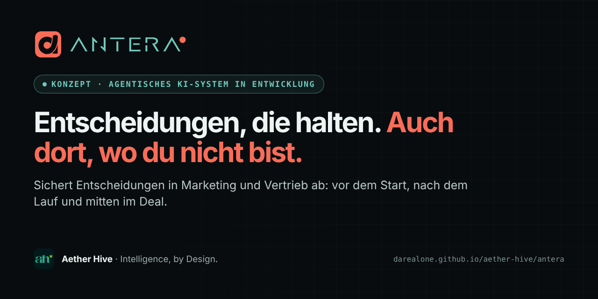

<p align="center"></p>

# ANTERA

**Konzept für ein agentisches KI-System, das Entscheidungen in Marketing und Vertrieb absichert: vor dem Start, nach dem Lauf und mitten im Deal.**

> **Status:** Konzept in Entwicklung. Diese Seite erklärt Idee und Architektur. Die interaktiven Demos zeigen den geplanten Ablauf mit fiktiven Daten. Es gibt keine Verbindung zu echten Systemen, kein Sprachmodell und keine Datenerfassung.

**Live-Seite:** https://darealone.github.io/aether-hive/antera/

---

## In short (English)

ANTERA is a concept for an agentic AI system that protects marketing and sales decisions at three points: before launch, after each campaign run, and inside live enterprise deals. It checks whether a campaign can work and prove its goal, explains where and why prospects were lost, and detects silent veto roles (works council, finance, IT) that can kill a deal in meetings the seller never attends. The agent works autonomously within strict limits: it may stop, never start. The page is in German.

---

## Das Problem

Gute Entscheidungen scheitern auf drei Arten:

| | Was passiert | Ebene |
|---|---|---|
| **Kaputt** | Die Kampagne geht live, ein Pflichtfeld erreicht das CRM nicht. Bemerkt wird es, wenn das Budget weg ist. | Ebene 1 · Verhindern |
| **Blind** | Traffic wie geplant, einige MQLs, wenige SQLs, null Deals. Niemand fragt, warum. | Ebene 2 · Verstehen |
| **Unsichtbar** | Der Deal stirbt im Lenkungskreis an einer Frage, die niemand vorbereitet hat. Im CRM steht „Kein Budget“. | Ebene 3 · Tragbar machen |

## Das System

Ein Fundament, drei Ebenen, ein Agent. Alle Ebenen teilen dieselbe Evidenzbasis und dieselben Regeln.

- **Fundament:** Versionierte Begriffe (Was zählt als qualifiziert, als Opportunity, als Verlust?), ein Evidenz-Graph über Kampagnen, Leads, Deals, Personen und Entscheidungen, ein Controller mit festen Regeln.
- **Ebene 1 · Verhindern:** Prüft die Kette vom Klick bis zum Deal vor dem Start und danach täglich. Bricht sie, pausiert das System die Ausgaben. Ergebnis: Launch-Check mit GO oder BLOCKED.
- **Ebene 2 · Verstehen und Lernen:** Untersucht jeden Lauf bis zum Deal, liest Verlustgründe und Gespräche und leitet den nächsten Lauf ab. Passen Absagen nicht zu dem, was in den Gesprächen stand, übergibt Ebene 2 den Fall an Ebene 3.
- **Ebene 3 · Tragbar machen (Decision Portability):** Erkennt stille Vetorollen und bereitet Antworten vor, die der Champion in Räume tragen kann, in denen der Vertrieb nicht ist.

## Autonomie: Darf stoppen, nie starten

| ANTERA darf selbst | ANTERA darf nie |
|---|---|
| die Prüfkette täglich neu ausführen | eine Kampagne starten oder neu starten |
| Untersuchungen starten, wenn Zahlen kippen | Budget erhöhen oder umverteilen |
| Verlustgründe mit Gesprächen abgleichen | etwas an Kunden senden |
| Antworten aus der Claim-Bibliothek entwerfen | Begriffe, Regeln oder Profile ändern |
| Aufgaben anlegen und Owner benachrichtigen | Menschen bewerten oder ranken |
| Ausgaben pausieren, wenn die Kette bricht | Unbelegtes als Fakt darstellen |

Pausiert wird vom Controller, ausgelöst durch eine feste Regel, nie durch eine Einschätzung des Modells.

## Spielregeln

1. **Beobachtet, abgeleitet, zu prüfen.** Jeder Befund trennt diese drei Dinge. Eine Abwesenheit in den Daten ist ein Hinweis, kein Befund.
2. **Darf stoppen, nie starten.** Schützende Eingriffe sind automatisch und umkehrbar. Alles, was Geld ausgibt oder Kunden erreicht, braucht einen Menschen.
3. **Keine erfundenen Versprechen.** Entwürfe nutzen nur Aussagen aus einer freigegebenen Claim-Bibliothek. Freigegeben heißt nicht beantwortet: Der Status zeigt jeden fehlenden Schritt.
4. **Entscheidungen bewerten, nicht Menschen.** Kein Scoring, kein Ranking von Mitarbeitenden.

## Architektur

```
Datenquellen ──► Aufnahme & Schutz ──► Evidenz-Graph
(Ads, Web,        Einwilligung,          Postgres (EU)
 CRM, Gespräche,  Pseudonymisierung      + Vektorsuche
 Produkt)                │
                         ▼
        ┌──── KI: darf lesen, untersuchen, entwerfen ────┐
        │  KI-Extraktion ─────────────► Investigator      │
        │  Zitate, Verlustgründe        Ursachen, Muster, │
        │  (JSON-Schema, Zitatpflicht)  Entwürfe          │
        └─────────────┬──────────────────────┬────────────┘
                      ▼                      ▼ nur Entwürfe
        ┌──── Code + Mensch: darf stoppen und entscheiden ┐
        │  Controller ────────────────► Owner             │
        │  Begriffe, Prüfkette,         Freigabe,         │
        │  Veto-Profile, Stopp-Regeln   Briefing, Neustart│
        └─────────────────────────────┬──────────────────┘
                                      ▼
   Launch-Check · Verlust-Diagnose · Nächster Lauf · Entscheidungs-Landkarte · Wochen-Digest
                                      │
                      Ergebnisse kalibrieren die Regeln (quartalsweise, durch Menschen)
```

**Bausteine, die es heute gibt:**

| Baustein | Umsetzung, z. B. |
|---|---|
| Connectoren | APIs von Ads, GA4, HubSpot oder Salesforce, Export des Call-Recorders, n8n |
| Evidenz-Graph | Postgres in der EU (z. B. Supabase, Frankfurt) mit pgvector |
| Controller | Zustandsmaschine und SQL-Regeln in Postgres, Pausieren über die Ads-API |
| Extraktion | Sprachmodell über EU-Endpunkt mit AVV, Ausgabe per JSON-Schema validiert |
| Investigator | Ein Agent mit acht lesenden Werkzeugen, geplante und ereignisgesteuerte Läufe |
| Claim-Bibliothek | Tabelle mit Freigabe durch Produkt, Legal und Datenschutz |
| Oberfläche | Seitenleiste im CRM, Digest in Slack oder Teams |

**Werkzeuge des Investigators (alle lesend):** `check_launch_chain`, `get_campaign_funnel`, `get_loss_reasons`, `get_reference_pattern`, `get_deal_timeline`, `get_stakeholders`, `search_transcripts`, `get_claims`.

## Umsetzung

| Stufe | Inhalt | Richtwert |
|---|---|---|
| Fundament | Begriffe mit Marketing und Vertrieb festlegen, Kampagne, Lead und Deal verbinden | 2–3 Wochen |
| Ebene 1 | Prüfkette als reine Regeln, tägliche Wiederholung, automatisches Pausieren | ca. 4 Wochen |
| Ebene 3, manuell | Pilot mit einem Vertriebsteam, einer Phase, einem Einwand | 6–8 Wochen, parallel |
| Ebene 2 | Lesender Investigator, evaluiert an vergangenen Kampagnen | ca. 6 Wochen |
| Mehr Autonomie | Ereignisgesteuerte Untersuchungen, automatische Erkennung nach Einwilligung | laufend |

Jede Stufe muss sich allein lohnen und ihre Abnahme bestehen, bevor die nächste kommt.

## Datenschutz und Mitbestimmung

Aufzeichnung nur mit Einwilligung, E-Mails standardmäßig nur als Metadaten, EU-Hosting und AVV mit allen Anbietern, Transkripte mit Ablaufdatum. ANTERA bewertet Entscheidungen, nicht Beschäftigte, und bleibt damit bewusst außerhalb der Hochrisiko-Kategorie des EU AI Act für Leistungsbewertung (Anhang III). Die Einführung wird mit dem eigenen Betriebsrat abgestimmt.

## Diese Seite

| Datei | Inhalt |
|---|---|
| `index.html` | Die komplette Konzeptseite inklusive Demos. Eine Datei, keine Abhängigkeiten, kein Build. |
| `social-preview.png` | Vorschaubild für geteilte Links (1280 × 640) |
| `favicon.svg`, `favicon-*.png`, `apple-touch-icon.png` | Icons |

**Lokal ansehen:** `index.html` im Browser öffnen. Es werden keine Daten gespeichert oder gesendet, keine externen Skripte geladen und kein Tracking verwendet.

**Barrierefreiheit:** Die Seite funktioniert per Tastatur, und die Architektur-Animation stoppt, wenn im System „Bewegung reduzieren“ aktiviert ist.

---

Alle Szenarien, Personen und Zahlen sind fiktiv. Ein Konzept von **Aether Hive**, *Intelligence, by Design.* Siehe auch [PARALLAX](../parallax/).
