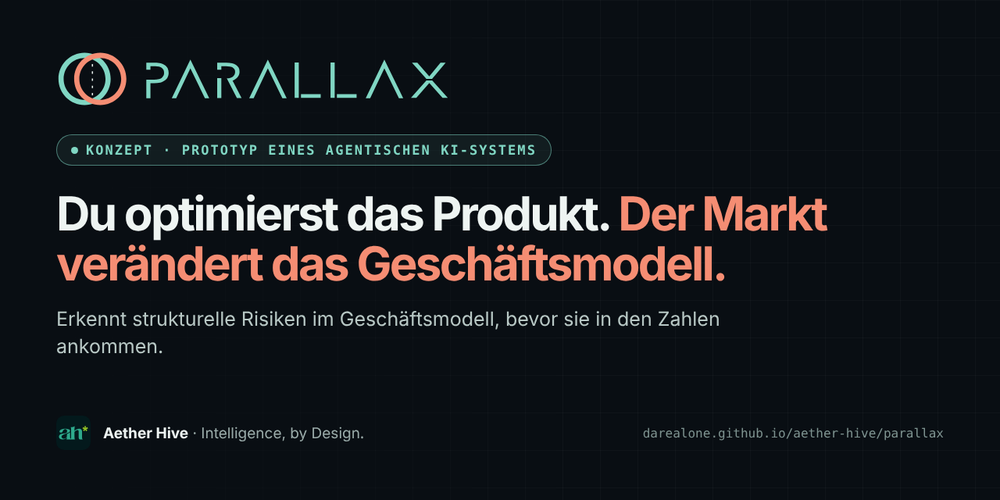

# PARALLAX

**Konzept für ein agentisches KI-System, das strukturelle Risiken im Geschäftsmodell erkennt, bevor sie in den Zahlen ankommen.**

> **Status:** Konzept mit lauffähigem Prototyp. Alle Daten sind synthetisch. Der Prototyp funktioniert vollständig offline: keine Verbindung zu externen Diensten, kein Sprachmodell, keine Prognose.

**Live-Prototyp:** https://darealone.github.io/aether-hive/parallax/

---

## In short (English)

PARALLAX is a concept and working offline prototype for strategic blind-spot analysis. Its starting question: what happens to seat-based SaaS revenue when AI agents let customers do more work with fewer paid users? It turns such shifts into falsifiable hypotheses with causal paths, early indicators and counter-evidence, runs transparent scenario calculations, and turns every hypothesis into an owned experiment. Not a forecasting machine, but a verifiable thinking system. The interface is in German.

---

## Die Ausgangsfrage

> Was passiert mit deinem Umsatz, wenn Kunden mehr Leistung mit weniger bezahlten Nutzern erzeugen?

Wenn KI-Agenten Arbeit übernehmen, kann die Wertschöpfung beim Kunden steigen, während die Zahl der bezahlten Seats sinkt. Der Anbieter verliert dann Umsatz, obwohl sein Produkt mehr leistet. PARALLAX macht solche Entkopplungen sichtbar und überprüfbar.

## Vier Hypothesen im Prototyp

| Code | Hypothese | Kern |
|---|---|---|
| H01 | **Seat Compression** | KI steigert die Produktivität der Kunden, während bezahlte Seats schrumpfen. |
| H02 | **Interface Displacement** | Der KI-Assistent wird zum Zugangspunkt, die Fachsoftware rückt in den Hintergrund. |
| H03 | **Pricing Mismatch** | Kunden kaufen Ergebnisse, das Produkt verkauft weiterhin Zugänge. |
| H04 | **Invisible Work** | Agenten erledigen Arbeit außerhalb dessen, was heutige Systeme messen. |

Jede Hypothese hat einen Wirkpfad, beobachtbare Frühindikatoren, eine Bedingung, die sie widerlegen würde, und einen nächsten sinnvollen Test.

## Der Prototyp

| Bereich | Was er zeigt |
|---|---|
| **Cockpit** | Kausalkette, Exposure Radar, Scenario Lab mit transparenter ARR-Rechnung und regelbasierte Frühwarnindikatoren |
| **Signale** | Evidenzregister: stützende und widersprechende Signale nebeneinander, mit Quelle, Datum und selbst eingeschätzter Belegqualität |
| **Hypothesen** | Wirkpfad, Gegenbeweis und menschliche Bewertung von Plausibilität, Auswirkung und Zeithorizont |
| **Experimente** | Test-Pipeline mit Owner, Prüffrage und Lernprotokoll |
| **Decision Brief** | Bericht aus Annahmen, Signalen und Experimenten, exportierbar als Markdown oder PDF |
| **Methodik** | Observe, Infer, Stress Test, Disprove, Act, Learn sowie die Grenzen des Systems |

## Prinzipien

- **Priorität ist keine Wahrscheinlichkeit.** Plausibilität × Auswirkung × Dringlichkeit ist eine Sortierhilfe, nicht statistisch kalibriert.
- **Synthetische Signale zählen nicht.** Demo-Einträge bleiben ausdrücklich außerhalb der Belegbilanz.
- **Jede These muss widerlegbar sein.** Gegenbelege stehen gleichberechtigt neben stützenden Signalen.
- **Rechnungen sind offen.** Das Scenario Lab nennt seine Formel. Steuern, Churn, Neukunden und Kosten sind bewusst ausgeschlossen.
- **Eine Warnung ist wertlos, wenn niemand etwas testet.** Jede Hypothese mündet in ein Experiment mit Verantwortung.
- **KI schlägt vor, Menschen entscheiden.** Verbindliche Berechnungen, Freigaben und die Trennung von Fakt und Interpretation gehören in überprüfbare Regeln und Menschenhand.

## Vom Prototyp zum System

| Im Prototyp umgesetzt | Für echten Betrieb nötig |
|---|---|
| Lokale Szenario-Rechnung, Risiko-Sortierung, Quellenregister mit Gegenbelegen, editierbare Hypothesen und Experimente, Regelindikatoren, Decision Brief, JSON-Import und -Export, Speicherung im Browser | Backend mit Rollen und Audit-Trail, verifizierte Datenquellen, Zeitreihen und Kohorten, versionierte Regeln, KI-Extraktion mit Zitatpflicht, Review-Freigaben, Monitoring, DSGVO-konforme Datenflüsse |

Der automatisierbare Kern ist die **Seat-Output-Divergenz**: Seats pro Kundenkonto sinken, während Projektvolumen oder Wertschöpfung stabil bleiben oder wachsen. Diese Konstellation lässt sich aus den eigenen Produkt- und Vertragsdaten laufend beobachten.

## Dieses Repository

| Datei | Inhalt |
|---|---|
| `index.html` | Der komplette Prototyp. Eine Datei, keine Abhängigkeiten, kein Build. |
| `social-preview.png` | Vorschaubild für geteilte Links (1280 × 640) |
| `favicon.svg`, `favicon-*.png`, `apple-touch-icon.png` | Icons |

**Lokal nutzen:** `index.html` im Browser öffnen. Eingaben werden nur im eigenen Browser gespeichert (localStorage). Mit „Snapshot“ lässt sich der Stand als JSON sichern und mit „Import“ wieder laden. Es werden keine Daten an Server oder Modelle gesendet und keine externen Skripte geladen.

---

Alle Werte sind synthetisch und stammen nicht von einem echten Unternehmen. Keine Prognose und keine Investitionsberatung. Ein Konzept von **Aether Hive**, *Intelligence, by Design.* Siehe auch [ANTERA](../antera/).
